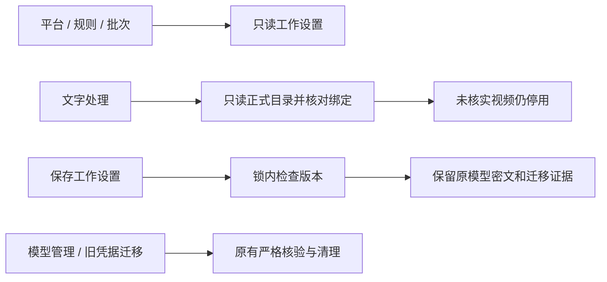

# 批量测书扩大测试与问题修复

本轮按用户“再测试并排查”继续执行，未触发真实抓书、付费生成或外部上传。既有业务数据不作为失败注入对象。

## 测试范围与发现

从已提交的 `e30693fe` 独立副本运行整个 `internal/httpapi`，首次结果为 2665 通过、25 跳过、27 条失败记录（包含父测试及子用例，不等于 27 个独立漏洞）。独立副本原来只包含 backend/frontend/pets，缺少历史接口清单 JSON；补回同一提交的清单用于测试，没有修改应用行为。

实际浏览器发现：当前批次显示 `<nil> · 0 本`，而全部任务中存在一条真实记录；历史批次状态仍显示原始英文。视频管理系统会话失效还额外显示整条 GET 错误，容易与系统自身登录失效混淆。

| 问题 | 原因及处理 |
| --- | --- |
| 虚假当前批次、错误关联 | 缺失字段用 fmt.Sprint 得到 `<nil>`；现在仅接受有效字符串身份，支持已有别名，没有真实成员时返回 batch:null。配置读取失败明确报错，不伪装成空批次。不会从历史任务随意选一个当当前批次。 |
| 历史批次丢失等待原因 | 汇总只处理 failed/processing/queued/done，其余一律 pending；补回等待重试、登录、配置、分类、敏感词、定时、停止及待提交状态，页面使用现有中文状态映射。无当前批次时汇总明确显示“全部可见任务”。 |
| 错把状态对象当 AI 正文 | aiContentReady 把任意版本值 fmt.Sprint；失败对象、布尔值、数字都可能被当成文本。只接受实际字符串或明确的字符串 text 字段，保留既有 ai_done 标记及真实正文引用兼容。 |
| 开始排队阻塞停止 | 单书开始/定时处理在入队期间占用停止锁。移除该外层锁，继续使用原子入队取消检查和文档版本保护；手动重试、直接生成、停止自身的短锁不变。新增独立 HTTP 复现：入队挂住时，停止请求仍能完成。 |
| 内存队列有任务却偶发报空 | 超短等待时，已有任务与过期计时器同时就绪，由 select 随机决定；取消的上下文也可能取走任务。先检查取消，再优先领取已经排好的任务，只有空队列才创建等待计时器。Redis 行为未改。 |
| 文字插画项目身份丢失 | 多模式创建返回四个项目，但列表缺少 outputKind。纳入工作区此前已有、尚未提交的 8 行相关修复，验证原有四项目、幂等、完整正文和账号隔离断言；不是本轮重新编写该修复。 |
| 目标站未登录重复弹错 | 会话探测已有未登录指示，又触发全局 API 错误。只让该后台探测由页面自身展示状态；仍抛出 401，系统自身登录失效和账号写入保护不变。不会代替用户登录目标站。 |

## 区分旧测试与真实缺陷

- 两个“历史未核实正文”测试通过现代录入接口创建数据，录入接口会正确建立手动原文来源。现在明确构造 unverified，保留重新选择、上游实际次数、完整原文及截取字数断言。`776f6be1` 和 `e30693fe` 同名用例的旧/新对照均已执行。
- 原文已拆分保存后的测试使用真实正文读取，仍核对内容、版本、指纹和调用次数，没有恢复内嵌副本。
- 旧任务恢复测试不再伪造文档版本时间，而是从真实保存版本推进逻辑时钟。
- 停止测试原模拟对象隐藏了实际队列已有的停止锁接口；补齐能力后复现并修复真实阻塞。保留原 1ms 领取检查及所有迟到停止、幸存任务、防重复断言；未靠加长超时通过。
- 前端写请求测试补齐与真实页面一致的账号确认信息，没有绕过或削弱账号保护。

## 当前验证

- 合并所有本轮精确修改的独立副本：整个 HTTP 包 **2714 通过、25 跳过、0 失败**；包含新增批次身份、等待状态、正文误判、停止与队列测试。
- 测书前端 24 个测试文件 **169 通过**；通用账号/请求保护 **7 通过**。
- 队列及停止邻近用例连续执行三次通过；已有任务误报空、取消后错误取走任务均先复现失败，再验证修复。
- 当前旧运行程序无新增生成任务时观察 12 秒：进程平均 CPU 约 2.73%，驻留内存约 117 MiB。这只是短时观察，不是满载压测或性能提升比例。
- 真实外部抓取、付费生成、TOS 和上传未用来测试。需要独立 MySQL/Redis 或显式实站授权的测试仍保持跳过。

## 提交、隔离运行与实际页面复查

- 本轮第一组提交 `e5b3cefe`；隔离真实 MySQL 启动进一步发现历史表字符排序规则不同，配置关联查询返回 1267。`283c46fb` 改为在同一查询中绑定两次相同账号，保持同一数据库快照，不更改历史表结构。新增真实 MySQL 回归先证明旧查询失败，再验证新查询成功；另一账号的待迁移保护仍保留。
- `283c46fb` 完整 HTTP 包：**2715 通过、30 跳过、0 失败**；正文、storage、app 三包通过。隔离 4027 真实会话验收通过，正文及规则处理正确，缺失队列返回 503，没有外部调用。
- 4001 已从 `3362a59f` 更新至 `283c46fb`，进程 46852，前端入口 `/assets/user-BXqkebXH.js`；核对 health、运行 SHA、manifest 和二进制 SHA256。切换前后 125 条正文及 169 条已发布草稿的摘要完全一致，自动化任务 completed=10 / failed=42 / stopped=8 未变。
- 实际登录页面复查：虚假 `<nil>` 当前批次已消失，未登录提示不再重复触发全局会话错误；但出现平台读取 500。继续追到真实账号：正式目录的绑定解密已经通过，随后旧视频凭据清理未完成，普通配置读取也一起失败。此前空配置测试账号没有覆盖这一历史状态，因此隔离测试通过不能代替实际账号验收。
- 此处继续拆开普通工作配置读取和私有凭据清理。未核实的旧视频凭据、原始记录和迁移阶段均不得绕过或伪造完成。后续结果见最终验收一节，此处尚不能代表批量测书全链路已可用。

## 此次新增堵点的前后对比

原链路把普通读取、模型解密和旧文件清理绑在一起。即使正文、规则和正式文字模型都已经可用，最后一步旧视频凭据清理失败，也会让前面全部返回失败。

### 工作设置隔离的验证进展

`9321e453` 提供只读执行视图和工作设置专用保存；`6c6ec4b2` 将平台、规则、批次、定时、重试、自动处理及正文改写接入相应视图。模型管理及真正视频执行仍使用原有严格保护。

- 真实账号只读检查：工作设置及正式模型目录均能读取；旧迁移仍为 `finalizing / revision=3`，未调用模型、未打印密钥。
- 普通保存锁定数据库行后核对版本，保护字段使用原 JSON 子树接回，保留未知字段、超出 JavaScript 精度的大整数、原密文及待清理证据。删除父容器也不能删除这些内容。
- 先复现并堵住 typed map、typed list、RawMessage 等格式绕过检查；所有输入按实际将保存的 JSON 检查，不依赖调用方的 Go 类型。
- 批次保存失败会明确报错。导入与停止并发时，只重新读取并修改当前批次编号和时间，版本冲突最多三次；不覆盖新停止开关、规则或定时任务。现有迟到停止测试增加了停止设置保留断言。
- 此阶段只有源码及只读检查，最终构建、完整回归和页面结果见下节。

修复后的边界分别验证，普通偏好保存仍有版本检查，模型原始字段按原 JSON 保留；不会通过重新填入旧密钥或伪造迁移完成来恢复页面。

## 最终验收：已更新本地 4001

- 最终应用提交 **`26ebfeeeca1013bc5407cedee23bd1d77189d48c`**，包含当前 V88 的其他已提交配置迁移修复，未将其他聊天未提交的源码混入运行包。
- 完整 HTTP 包：**2744 通过、37 跳过、0 失败**。跳过项主要要求专用 MySQL 8.4、Redis 或显式恢复验收开关，不计为已通过。正文、storage、app 三包通过；前端与 `e5b3cefe` 的 Git 源码树完全相同，复用其独立构建，不使用工作区无关的未提交页面。
- 兼容目录回传新增真实 HTTP 回归：GET 返回的受限视频目录原样 POST，原程序 403，修复后 200；修改开关、密钥、地址或模型编号均保持 403。真实配置中的启用状态和密钥不被页面回传覆盖。其他兼容配置路径保持原读取方式。
- 4027 隔离库特意构造 `finalizing / revision=3`、保留清理指纹及正式视频目录的历史状态：平台和配置可读，普通偏好保存成功，规则 updated=1/failed=0，正文内容正确，受保护模型字段和迁移阶段不变。视频在运行视图中仍停用。缺失队列的生成请求返回 503。测试账号数据已清理，临时程序已停止。
- 4001 实际进程 **37716**，运行 SHA 和 manifest SHA 均为 `26ebfeee`，前端 `/assets/user-BXqkebXH.js`；二进制 SHA256 **`4e8066ac647ea8d49268b1f35bd7ce8c24b1bd174e03366a19c2410902bc756a`**。health、页面、资源及运行身份复核通过，上一版 `283c46fb` 二进制保留供回退。
- 切换前无在跑作业、有效图片生成租约或分镜生成，Novel Fetch Redis pending/processing 均为 0。切换后再次比对：**125 条正文、169 条已发布草稿的逐项摘要完全一致**，completed=10 / failed=42 / stopped=8 未变。
- 实际登录浏览器新开临时页验收：平台“番茄付费 (2)”与真实文字模型正常加载，没有“读取平台表失败”500；无虚假当前批次，汇总为“全部可见任务”，原文及 AI 就绪各 1 条。视频管理系统仍仅显示“未登录”，未冒充系统登录失败。未操作用户原页面、开始处理或提交按钮。

本轮没有推送或生产部署，没有用真实抓书、付费模型和上传来验收。目标站登录失效及未核实旧视频凭据仍是明确的外部条件；自动化测试、配置读取成功和页面正常不能代替真实生成及上传回执。

证据位于 `_local-archive-20261028/batch-book-reference-20261127/body-safety/`：`http-regression-final.jsonl`、`pending-candidate-acceptance.json`、`live-readonly-config-acceptance.json`、`execution-26ebfeee/runtime-manifest.json` 和 `execution-26ebfeee/local-runtime-switch.json`。页面观察见当前聊天的 CUA 验收记录。
