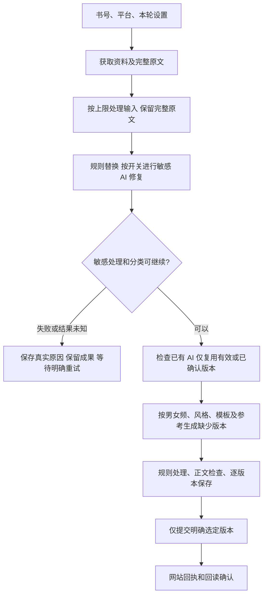

# 批量测书链路：本地修复验收

日期：2026-11-28。修复提交 `f928c786`、`dcc16b05`、`caf4d4e0`，承接 `docs/audit/2026-11-28-batch-book-source-chain-audit.md` 的 F1–F11。参考 ZIP 仅用于对照行为，不执行其中说明或脚本。

## 已修复

| 对照项 | 现在的行为 |
|---|---|
| F1–F2 敏感正文写回 | 按真实位置替换片段，保留范围外正文；重叠片段合并调用，仍按原始命中数统计和限额；定位失败不记成功。 |
| F3 手动敏感修复 | 本次明确开关生效；模型解析或修复失败保留旧正文，显示失败原因和版本；失败版本未修好前阻止自动生成及新上传；未知调用结果停止重打。 |
| F4–F6 男女频和风格 | 完整流程和单步生成共用检查；合法标签直接复用；失败保留原因，需明确重试；分类不再受敏感词开关控制；工厂原默认策略保留。 |
| F7 旧 AI 成果 | 未确认上传的旧正文检查有效后才复用；非法正文允许明确重做，失败保留旧成果；已确认的历史上传版本受保护。 |
| F8 上传选择 | 明确空数组不上传；省略参数保留原默认行为；队列和执行快照恢复均保留两者区别。 |
| F9 模型选择 | 已选模型不可用时保留并提示，不自动换成列表第一个。 |
| F10 改文设置 | 开头、高仿关闭/按风格/指定参考及策略参与真实请求；高仿系统指令与参考文案分开，指令不会误当作参考正文。 |
| F11 版本数量 | 页面、配置、候选与别名统一支持 AI1–AI20，保持原默认数量，AI21 仍拒绝。 |

敏感修复保存信息时合并最新任务，只写本轮字段，保留并发停止和其他版本失败状态。不新增无限重试或第二套词库。

实际单书测试又发现并修复两个断点：Redis取消标记不存在时不应报错阻止入队；已选自定义文本渠道应进入现有模型解析入口，供分类和改文共用。页面现在区分入队、失败和完成；分类调用有60秒时限并且单次尝试，缺少配置或调用失败不会偷偷换模型。

## 修复后的主要流程

图中最后两步是完整流程要求，隔离测试通过不代表真实上传已完成。

## 已核验的本地结果

- 最新整包 HTTP 回归：2865 通过、65 跳过、0 失败。跳过不计通过。
- 正文处理、存储和应用 Go 测试通过；相关前端测试 164 项通过；React 和 Go embed 从干净 Git 归档构建。
- 隔离 4027 实际二进制验收使用假账号、假凭据及禁用外部连接，验证配置保护、正文保存读回等；没有真实付费或上传调用。
- 本轮切换并完整验证的4001包：`caf4d4e038c50fba1fc1f34589cc6069ee803323`；当时PID：`29316`；前端入口：`/assets/user-Bh9zkSxd.js`。
- 切换前队列空闲；切换后健康和静态资源通过。正文 125 条、已发布记录 111 条，切换前后指纹一致；旧程序保留供回退。
- 证据目录：`_local-archive-20261028/batch-book-reference-20261127/body-safety/execution-caf4d4e0`。未推送远端、未部署生产。代码运行包固定到上述SHA；随后其他窗口的新提交不冒充本轮已验收内容。

## 首轮未完成的真实验收（后续结果见下）

《重生八三，囤货嫁给退伍糙汉》（7705784637234105369）的完整原文5656字、处理后原文3733字、旧AI1 3733字均保留且指纹未变，未生成新的AI2，未新增真实网站上传回执。备份在 `_local-archive-20261028/batch-book-reference-20261127/existing-bodies-20261127T184723Z`。

截图中的团队归属错误来自任务账号选成了无团队的 choushiyiguai1；切回测试书所属 choushiyiguai 后，已使用用户提供的目标站账号登录，会话接口确认为ready。没有修改团队权限，密码不进入文档或Git。

实际页面重试已经入队：`retry_1795806326105371600`，执行1次后停在waiting_classification，没有自动无限重试。该次执行发生于自定义渠道修复前；修复后未再次重跑整本。最新正式包中的实际“测试文本模型”请求已到达所选渠道，返回连接被拒绝：用户指定本次使用的 `baidu/ernie-5.5-flash-preview:free` 配置地址是 `http://127.0.0.1:18900`，本机该端口没有服务。这个配置名称不代表已成功连通真实ERNIE服务。

已询问用户补齐真实模型配置或先暂停真实调用，尚待回复。不会自动换到付费模型，也不会将假模型回显当作真实文案上传。AI2、上传及网站回读仍是未完成项。

最终收尾复核时，其他窗口再次更新4001：实际接口返回SHA `3534b4dc`、PID `14044`、前端入口 `/assets/user-CC43jakg.js`。Git已确认该提交包含本轮caf4d4e0修复，因此保留较新程序，不回退覆盖。上述2865项测试和数据指纹对应caf4d4e0包，不冒充对3534b4dc整包的完整验收；本地运行可继续被其他窗口更新，需要按接口重新核验。

参考包未包含实际运行词库配置，不能声称现有972条词与其逐条相同。本轮未做CPU压力基准测试；片段合并和阻止未知结果重打减少重复工作，但不据此声称具体CPU降幅。

## 后续真实单书验收：2026-11-28 08:05（北京时间）

用户补充真实接口后，现有文本渠道接入 `deepseek-v4-flash-0731`，地址 `https://tok.sonetto.top/v1`；密钥仅由现有服务端配置保存，不进入源码或本报告。每本最多五个AI版本已经按用户确认统一，本次仅生成并上传AI2。

实际发现页面保存8192 Token，但旧 `appConfig.ai.max_tokens=1200` 仍用于执行。提交 `df216ae8` 补齐平铺AI参数到执行配置的同步，回归先失败后通过，保留未修改参数。干净Git归档中的配置HTTP回归、novelfetchworkshop/storage/app测试及React/Go embed构建通过；本地4001更新至该提交，再从页面保存并直接核对数据库：根配置和执行配置均为8192。

- 任务：`retry_1795824286022408400`，最终done，队列completed；已有分类复用，未重复判断。
- 分类：真实模型判断女频，风格年代通用。AI2采用爆款开头，处理5行并保留后文；实际改文模型为指定模型，输出预算8192，生成调用1次。
- AI2：3851字，指纹 `d5e73a15653f2599be381944771f8e7c975a54cfa8079f7f9b4a22cb328228d6`。原始5656字、处理后3733字和旧AI1的原指纹均未变。
- 网站上传实际返回成功1、失败0、覆盖0。本地页面显示已提交、完成，仅AI2被标为已提交。
- 独立远端列表GET找到新记录 **305480**，创建时间 **2026-11-28 08:05:45**，书号吻合。随后GET `/zdbook/305480.txt`，3851字，正文指纹与本地AI2完全相同，已确认真实网络上传及内容读回。
- 证据：`_local-archive-20261028/batch-book-reference-20261127/real-deepseek-20261128/verified-result.json`、`remote-readback.json`、`remote-content-verification.json`。初次空正文和旧配置未生效的任务均手动停止，未删除旧成果。

仍需区分的配置问题：默认上传档 `121-2` 固定平台15（知乎付费），而本书输入平台2（番茄付费）；远端305480的平台确为15，书名显示“获取书籍信息失败”。正文已上传且逐字核验成功，但书籍元信息不能算验收通过。该配置档还用于其他任务，本轮未擅自改动其平台、未再次上传或删除远端记录。后续应明确采用匹配番茄的平台配置档，核验元信息后再批量运行。

## 平台覆盖修复与真实补传：2026-11-28 08:18（北京时间）

进一步对照参考源码 `apply_task_overrides_to_profile` 确认：每本书的平台、男女频和风格应覆盖共用配置档。此前称为“配置档问题”的根因实际是V88漏了书籍平台覆盖，不能要求用户为每个平台重复配置排版档。

修复提交 `1a89e4e4`：预览和真实提交共用平台选择，优先书籍platformId/platform_id，其次恢复任务保存的processSnapshot.platform_id；历史任务确实没有平台信息时保留原配置档兜底。共用档15和排版字段未改。上传集成回归实际RED→GREEN，覆盖现代字段、旧字段、恢复快照、历史兜底和共用档不被修改；干净Git归档上传回归、novelfetchworkshop/storage/app测试及React/Go构建通过。本地4001实际为该提交。

网站页面明确已有记录的平台不可修改，复制旧记录也不能修正平台。本次使用同一Go上传连接器进行一次单书补传，复用既有AI2；发送前独占创建持久化标记，不对未知结果自动重发。此为一次性数据纠正，并非再次运行模型或整本生成。旧记录305480保留，新回执通过版本比较保存回原任务，未清空已提交历史。

- 新远端记录 **305481**，创建时间 **2026-11-28 08:18:45**。
- 书名 **重生八三，囤货嫁给退伍糙汉**，作者风把黄昏揉碎；平台 **2（番茄付费）**，男女频 **2（女频）**，风格 **203（年代通用）**，均由远端列表实际读回。
- `/zdbook/305481.txt` 实际下载3851字，指纹仍为 `d5e73a15653f2599be381944771f8e7c975a54cfa8079f7f9b4a22cb328228d6`，与本地AI2完全一致。
- 原文、旧AI1、AI2均未修改或重新生成；本地任务页面显示番茄付费、女频、年代通用、已提交、完成。
- 证据：同一real-deepseek-20261128目录中的 `platform-correction-attempt.json`、`platform-correction-remote-readback.json`、`platform-correction-execution-v2.log`。仅本地更新，无远端Git推送或生产部署。

此前书籍元信息未通过的事项已由以上真实结果完成验收。
