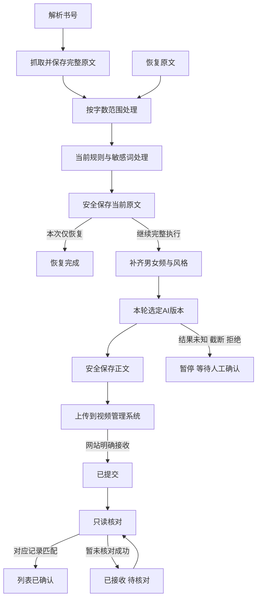

# 批量测书 R1–R7 修复与本地验收

更新：上传管理遗漏的500错误已补齐，已有账号已真实登录、同步并保存成功；最新本地运行2e744ac1，见[真实登录与上传配置验收](2026-11-28-batch-book-upload-management-live-repair.md)。以下保留首轮R1–R7验收记录。

日期：2026-11-28。范围为批量测书完整链路，依据已批准的[设计](../superpowers/specs/2026-11-28-batch-book-safety-and-results-design.md)、[执行计划](../superpowers/plans/2026-11-28-batch-book-safety-and-results.md)和[源码对比审查](../audit/2026-11-28-batch-book-deep-chain-design-audit.md)。安全与并发处理属于V88补强，不代表参考源码已有同样实现。

## 修复结果

| 环节 | 排查前的问题 | 本轮结果 |
| --- | --- | --- |
| R1 恢复原文 | 直接恢复raw可能绕过规则，旧模型结果可能覆盖停止/修改 | 先按maxTxt处理，再走当前规则和敏感处理；沿用任务指定模型；条件写入保护停止和并发修改，失败保留旧正文；raw/AI不变 |
| R2 错误安全 | 上游回显凭据进入错误、日志或历史页面 | 自定义渠道和模型目录入口先精确隐藏本次凭据，保留错误类别；保存与历史错误视图继续脱敏，正文不改 |
| R3 有效参数 | 保存的TopP、惩罚、思考与额外参数未完整下传 | 男女频、风格和改文共用参数组装；业务固定字段优先；禁止覆盖模型/消息/凭据/输出协议；温度同步、思考互斥、流式禁用 |
| R4 超时 | 改文被分类60秒或HTTP客户端300秒截短 | 分类保持60秒；改文缺省180秒，按有效1–900秒设置；更短的父请求期限仍生效 |
| R5 重试 | 内部循环与阶段重试叠加，0次重试仍再执行 | 单个改文请求执行只发送一次；0/1/2次额外重试分别最多1/2/3次失败；格式修复最多一次延迟重试；未知、截断、拒绝及配置问题暂停 |
| R6 上传证据 | 网站接收成功被误写为回读/正文已确认 | 接收仍算提交成功；只有实际匹配回读记录才列表确认；读取失败保留待核对，按钮只读重试；未下载正文不标记正文已核对 |
| R7 本轮进度 | 旧AI1可能掩盖本轮缺失AI2，旧失败混入本轮 | 按本轮明确选定AI1–AI5统计；空选择和仅原文无需AI；已保存正文引用优先；无快照历史行保留兼容 |

交叉审查补齐：思考复选框真实绑定；恢复成功标为就绪并记录恢复事件，随后完整执行不重复原文敏感调用；任何响应读取损坏（含gzip校验失败）均按未知结果处理；“已接收，待核对”可以直接点击原只读核对按钮。

## 当前链路

恢复原文只改original；完整原文original_raw、旧AI版本和有效上传回执保留。核对循环不调用上传接口。列表确认与实际下载正文核对是两种证据。

## 验证记录

- 前端：176通过，0失败。
- 模型公共模块：779个测试/子测试通过；隔离MySQL正文保存：11个测试/子测试通过。验证提交4cc0d16f；与最终e636f4d4的这两个模块源码逐文件一致。
- 最终e636f4d4干净Git归档：React构建成功，novelfetchworkshop/storage/app测试通过，Go embed二进制构建成功。
- 独立运行4027与独立数据库nfw_body_safety_runtime_20261127：真实HTTP恢复后规则生效；raw和AI1的版本与hash不变；配置凭据封存、旧模型配置保护、无队列拒绝执行等均通过。Redis禁用，真实模型和上传调用为0，测试进程结束。
- 完整HTTP回归：2973个测试/子测试通过，65项按环境条件跳过，0失败。。
- 独立只读整合审查：发现的“待核对缺少按钮”P2已修并复核关闭，无剩余审查阻塞。

最初公共模块归档少了一个已跟踪的prompt测试文件；从相同Git提交补齐测试资料后779项全过。HTTP旧恢复测试只给相同正文hash，未给本次时间证据；已补与目标站一致的上海时区日期时间，保留不重复上传断言，未放宽真实核对要求。

## 本地运行与数据保护

- 程序源码提交：e636f4d47fd4dda8b6b9c05f3886ae2e03aae03d。
- 前端入口：/assets/user-Cskv85St.js。
- 二进制SHA256：2fd4a174ad996ed5409b8091be68d80a37f7d22f88f70de3a5f3312481f21065。
- 本地4001更新：完成。PID16292；健康接口200；运行源码SHA、构建清单SHA及前端入口一致；旧6527b60e程序保留回退点，切换时pending/processing均为0。126份正文与111条已发布记录的整体指纹完全一致。。
- 测试书7705784637234105369：完整文档（含回执）SHA256及original_raw/original/AI1/AI2的正文版本、字数、状态和hash均与切换前一致。页面仍显示女频、年代通用、3733/5656、已生成、已提交、完成。。
- 浏览器实际核验：本轮AI就绪1/1；AI超时180秒、自动额外重试2次、流式禁用、模板决定JSON、思考复选框真实绑定。只查看，未保存配置或执行任务。页面当前显示视频管理系统未登录；原会话文件、账号及cookie均仍保留，未重新登录，下一次真实上传前需有效登录。
- 本轮没有真实模型重测、没有新增上传、没有推送或生产部署。已有远端305481的历史正文下载比对验收保留，本轮没有重新请求远端证明。

临时证据位于`_local-archive-20261028/safety-repair-20261128/`；最终干净构建、HTTP日志及切换回退记录位于`_local-archive-20261028/batch-book-reference-20261127/body-safety/execution-e636f4d4/`。无关工作区修改保留，未新建分支。

并行提交说明：本地切换完成后，另一个会话新增1a3371cb（批量工厂文本页重复渲染修复）。本次4001验收运行仍为e636f4d4；该后续提交未纳入本次运行，批量测书修复路径未发生后续修改。
