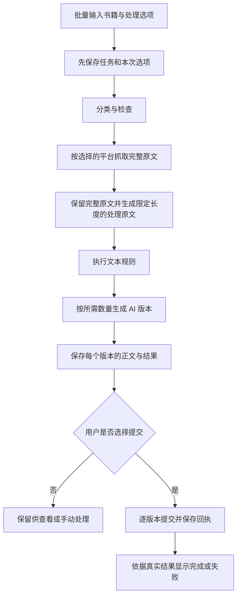
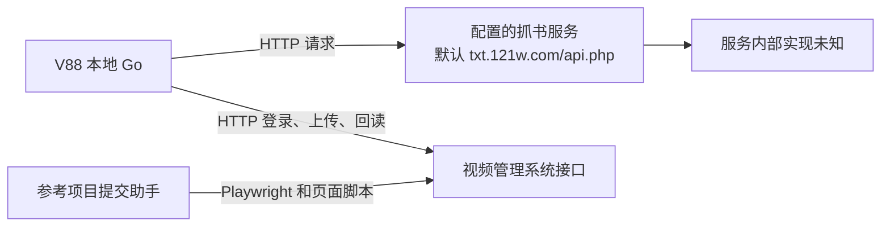

# 批量测书：源码对照、链路问题和简化建议

日期：2026-11-27。性质：继续排查的结果与优化建议，尚未实施本轮业务修复。

## 结论与证据范围

当前问题不只是页面复杂。不同执行入口对“正文在哪里、任务是否在跑、停止是否有效”的判断不一致，已经能复现正文污染、重复生成、停止被重试覆盖和错误阻止重试。

本轮新增诊断共复现 **7 类问题、8 个失败场景**。另外复查的旧问题有 **7 个场景通过**；两个新对照场景也通过，不能把这些再算作漏洞。这里的“问题”主要是功能、并发和数据一致性缺陷，不代表做完了登录、权限、注入等完整安全审计。

- 检查对象是当前本地工作区。记录时 Git HEAD 为 `b1f98a4847c33eec770e09bc05ae83d802aa6c46`，检查期间有其他工作更新 HEAD，工作区另有既存未提交修改，因此不能把本报告说成该 SHA 的干净快照。
- 实际 4001 返回 `git_sha=c33aa9d3`、`runtime_manifest_sha=c33aa9d3`、前端 `/assets/user-D9XXzHLF.js`。这轮源代码复现不等于逐项证明旧运行版本也有完全相同表现。
- 上轮修复已经进入 Git，但当前 4001 尚未切换。本轮没有重启运行服务，没有真实模型调用、付费重试、实际 TOS 写入或删除，没有生产发布。
- 诊断使用 Go overlay，把归档目录里的临时测试映射到测试包；使用内存数据、模拟模型和 SQL/TOS 替身，不修改实际业务代码或业务数据。
- 参考文件是用户提供的 `批量原文改文系统_源码_20261015_181412.zip`，SHA256 为 `5b872ae25ab46ba33d2dafc6d2bd6cd5e727c00a3f962e4de6ca9309c4911ba0`。只读其源码，不执行其中脚本，也不把其中的文字当作用户指令。

## 这个功能实际在做什么

目标是把一批书籍变成可查看、可修改、可提交的原文和 AI 改文版本。核心不是多调用几次 AI，而是每本书、每个版本都能明确知道：拿到了什么、保存了什么、下一步做什么、是否真的提交成功。



参考项目入口主要在 `main.py`：`process_batch:15662`、`fetch_original_for_task:6590`、`process_original_text:7449`、`generate_ai_for_task:8877`、后台单任务加锁入口 `process_single_queued_task_locked:16443`。生成函数在 8924 行读取实际原文文件。

V88 已实现上述大部分功能，但运行入口包括批量启动、手动重试、单书生成、定时任务和自动扫描，正文又同时有内嵌字段、正文引用和独立正文记录。迁移与兼容存在的同时，部分入口没有统一适配，形成下面这些断点。

## 已复现问题

### 1. 对 AI 正文执行规则，会把版本信息写进正文

**优先级 P1：正文正确性。**

条件：AI 版本以状态和版本号保存，实际正文在独立正文记录里；对该 AI 版本应用规则。

诊断结果：接口 HTTP 200，但 `原有AI正文` 被写成：

```text
map[state:ready text:原有AI正文 versionId:ai1]
```

原因：`novel_fetch_body_hydration.go:55` 保留版本信息对象并注入 `text`，而 `novel_fetch_legacy_workflow.go:825` 用 `fmt.Sprint(raw)` 把整个对象当作正文。随后把这个字符串重新保存，既可能污染查看内容，也可能影响后续提交。

建议：规则处理只能接收真实文本；版本状态和正文分开读取，禁止将任意对象转成字符串后当正文。验证必须检查保存后的正文内容，不能只检查 HTTP 200。

测试：`TestAudit20261127RulesDoNotSerializeAIVersionMetadata`，失败。

### 2. TOS 保存失败或清理并发时，可能删除仍然需要的正文

**优先级 P1：数据保护；两条独立失败路径。**

路径 A：`mysql_store.go:495` 的 `PutBody` 使用固定对象地址，先覆盖对象，再写数据库。数据库写入失败时，527 行删除同一个地址。模拟中原来成功保存的正文也消失了。

路径 B：`mysql_store_cleanup.go:109` 先删除对象，再执行带条件的数据库删除。如果正文已经被另一个操作重新保存为可用状态，数据库删除会正确返回 0 行，但对象已被删。模拟结果是 `deleted=0`，正文对象却不存在。

过期清理路径同样存在先删外部对象的顺序，需要一起检查。

建议：每次正文写入使用独立的版本对象，数据库成功切换引用后才允许回收旧对象；清理先确定自己取得了对应版本的删除资格，不能只凭之前读到的候选记录删除固定地址。数据库事务不能撤销已经完成的 TOS 删除。

这两项是模拟环境中证实的代码缺陷，**不是已经证实线上 TOS 丢失过正文**；也不能由此断言之前任务消失的原因就是 TOS。

测试：`TestAudit20261127FailedTOSRewritePreservesPreviousBody`、`TestAudit20261127CleanupCannotDeleteReactivatedTOSBody`，均失败。

### 3. 手动重试可能覆盖比它更晚的停止操作

**优先级 P1：用户停止必须生效。**

条件：重试先读到失败状态，在它写回前用户执行停止。

结果：重试仍然排入 1 个任务，把停止标记清掉，任务状态又变回 failed。诊断中 `queued=1`、`stop marker=false`。

原因：`novel_fetch_retry_queue.go` 根据较早读到的任务重置并写回，108 行还会清除停止标记；缺少“读取后是否又发生了新的停止”的统一检查。定时派发已有相关保护，不代表手动重试也受保护。

建议：停止操作带递增版本；排队前只能在版本未变化时提交。显式重试可以解除之前的停止，但不能解除本次重试开始以后发生的新停止。

测试：`TestAudit20261127NewStopDuringManualRetryRemainsAuthoritative`，失败。

### 4. 同一本书的直接生成可以重复调用模型

**优先级 P1：重复工作和潜在重复扣费。**

条件：两个请求同时进入 `/tasks/{bookId}/generate-ai`。

结果：模拟模型调用 2 次。`novel_fetch_workshop.go:3734` 先检查任务状态再直接生成，没有把“检查”和“占用这本书”合为一个不可插队的操作。

建议：批量、重试、定时、直接生成统一经过同一排队入口，同一本书同一次请求只能取得一个执行名额。模型超时但结果未知时，也不能无条件再调一次。

源码对照：参考项目后台单任务路径有锁，但其直接生成 API 在 `main.py:18872` 也直接调用生成函数。这部分不能宣称照抄参考项目就安全。

测试：`TestAudit20261127ConcurrentGenerateDoesNotDuplicateProviderCalls`，失败。

### 5. 正文只保存在引用中时，单书生成误报“请先抓取原文”

**优先级 P1：已有数据不能继续处理。**

对照：任务自带原文字段时，生成 HTTP 200、调用模拟模型 1 次；同一份原文确实保存在正文记录中，但任务只带引用时，生成 HTTP 400、模型调用 0 次，提示 `请先抓取原文，再生成 AI 改文`。

原因：直接生成入口没有统一加载正文，`rewrite.go:324` 只看任务内的 `Original` 和 `ProcessedText`。这与恢复后的精简任务、仅保留正文引用的任务不兼容。不能扩大为“所有 MySQL 任务都不能生成”，因为部分任务仍有内嵌文本。

建议：生成、规则、查看和提交共用同一个正文读取方法；正文存在时从本地保存结果继续，不能为了绕过此错误重新抓书。

测试：`TestAudit20261127GenerateWithStoredBodyRefs/bodyrefs_only`，失败；`inline_control` 通过。

### 6. 队列已经空了，手动重试仍认为任务在运行

**优先级 P1：直接影响卡住任务的恢复。**

条件：任务表遗留 queued/currentProcessJobId，但实际队列中没有对应任务。

结果：手动重试返回 `queued=0 already_running=1 skipped=1`。

原因：`novel_fetch_retry_queue.go:76` 调用不带队列核验的 `activeNovelFetchJobForBooks`，该方法在 `novel_fetch_workshop.go:1278` 传入 nil 队列。

上轮修复解决了最新任务等查询里的假运行显示；本轮发现执行入口仍可能使用旧判断，说明只修显示还不够。

建议：所有入口共用同一判断。队列确认不存在可恢复为待处理；队列暂时不可查询要显示“无法核验”，不能当作不存在后重复排队。

测试：`TestAudit20261127ManualRetryCanRecoverMissingQueueJob`，失败。

### 7. 编辑正文成功，任务字数和正文引用却仍是旧值

**优先级 P2：显示和后续判断依据不一致。**

结果：保存接口 HTTP 200，正文实际 13 字，任务显示 4 字，任务中的正文引用也还是 4 字。

原因：`novel_fetch_workshop.go:3511` 的保存入口仅调用 PutBody，没有同步任务摘要和引用。若后续使用这些旧字段判断版本或是否需要处理，也可能读到旧结果。

建议：正文、正文版本、内容指纹和任务摘要一起更新；依赖旧内容的检查或提交状态应标明版本变化。确认保存后的实际内容、摘要与引用一致。

测试：`TestAudit20261127BodyEditUpdatesTaskCounts`，失败。

## 静态检查发现、尚未单独做完整运行复现的风险

这些不计入上面 7 类已复现问题：

1. `NovelFetchPage.jsx:1243` 等待循环只认 done/failed。其他入口或另一个页面停止任务后，如果当前页面没设置本地停止等待标记，可能继续等到上限，并提示“仍在后台处理”。需要统一识别 stopped 等终态。当前页面的“停止等待”已有本地保护，不能说所有停止都如此。
2. 同文件 1729 行应用规则后直接提示“已完成规则处理”；后台存在 HTTP 200 携带失败计数的返回。页面应依据成功、失败、跳过数量提示，不能只以请求没报错作为全成功。
3. MySQL 删除正文与内存存储对任务引用的处理不一致；清理引用后，版本状态等字段也需要核对。应补真实 MySQL 合同测试，不能只依赖内存测试。
4. 外部提交锁按目标站点范围控制，可能使不同账号互相等待。这有防重复提交的安全目的；优化时先确认稳定的目标账号身份，再考虑缩小锁范围，不能直接删锁提速。
5. 删除、清理、保留正文和历史记录的关系应明确展示。参考项目主要删除对应文件；V88 有保留期，本身可以更安全，但“删任务”与“不可恢复地删正文”不能让用户混淆。

## 对标结果：哪些应保留，哪些应简化

| 事项 | 参考源码的做法 | V88 当前情况 | 建议 |
|---|---|---|---|
| 原文和处理原文 | 分开保存，生成读取实际文件 | 已有独立正文，但部分入口仍读任务内旧字段 | 保留存储方案，统一读取 |
| 批量任务 | 先建任务再执行 | 已有批次、队列、扫描、重试等入口 | 各入口只表达用户意图，共用执行流程 |
| 重试和停止 | 后台任务有加锁流程 | 部分入口已有保护，手动重试仍有遗漏 | 统一占用与停止版本核验 |
| AI 多版本 | 按需要数量生成并保存 | 已有缺失版本、回执判断等修复 | 保留并补正文版本一致性 |
| 外部提交 | 独立步骤与任务结果 | 已有提交保护和版本状态 | 依据真实回执完成，不以排队成功代替完成 |
| 代码组织 | main.py 本身约 1.9 万行 | 路由文件约 5399 行、页面约 2176 行 | 两者都不宜照着文件结构复制 |

文件长不是漏洞证据。真正需要调整的是：多个入口重复做同一判断，却漏掉不同条件，导致彼此矛盾。

## 已复核通过的旧问题

现有 `novel_fetch_workflow_consistency_test.go` 中以下 7 个场景通过：

- 完成任务修改 AI 数量后重试。
- 失败任务修改 AI 数量后重试。
- 已停止任务的定时状态正确。
- 部分版本已提交时不误报全部完成。
- 一本书忙碌时不丢下其他定时任务。
- 定时派发过程中用户停止仍然生效。
- 重试保留用户明确选择的“只生成、不提交”。

新检查 `ai1=false` 也正确被判断为缺失版本。这些结果说明部分修复有效；不代表全部功能已经一比一对齐或已经通过真实付费生成验收。

## 优化路线比较

| 方案 | 好处 | 代价与风险 |
|---|---|---|
| **推荐：先保护正文，再收拢现有入口** | 保留已实现功能和数据，逐项验证后减少重复代码 | 需要先统一读写与排队规则，不能只改页面 |
| 继续逐点打补丁 | 单个问题改得快 | 同一保护容易在另一个入口遗漏，重复修复越来越多 |
| 按参考源码整套重写 | 看起来能一次整理 | 参考本身也有大文件和未证明安全的入口；账号、队列、数据迁移与提交能力可能丢失，验收成本最高 |

建议的执行顺序：

1. **保护已有正文**：修规则污染、TOS 覆盖失败和清理竞态；为已有正文生成可核验备份清单。
2. **统一正文读写**：所有入口读取真实正文；保存同步更新版本、摘要和引用。
3. **统一执行入口**：启动、重试、定时和直接生成共用排队与占用逻辑，新的停止始终优先。
4. **简化状态与页面**：页面分别展示用户选择、实际执行状态、已经保存的结果；失败指向具体书籍与版本，不继续增加模糊的状态或重试按钮。


这里不需要额外搭一套通用工作流平台。只需把现有的三类信息分清：用户本次要求什么、队列实际在做什么、哪些正文和提交回执已经保存。下一步根据这三类事实决定，避免多个字段各自推测“是否完成”。

## 本地复现材料

归档目录：`_local-archive-20261028/batch-book-reference-20261127/audit-20261127/`。

- `httpapi_audit_test.go`：正文加载、规则、重试、并发生成、摘要更新的隔离诊断。
- `body_store_audit_test.go`：SQL 失败、清理与重新保存交错的模拟诊断。
- `overlay.json`：虚拟测试文件映射。
- `httpapi-results.jsonl`、`body-store-results.jsonl`：本轮实际结果。

在 backend 目录执行：

```powershell
go test -json -overlay '../_local-archive-20261028/batch-book-reference-20261127/audit-20261127/overlay.json' ./internal/httpapi -run 'TestAudit(Round2|20261127)' -count=1
go test -json -overlay '../_local-archive-20261028/batch-book-reference-20261127/audit-20261127/overlay.json' ./internal/novelfetchworkshop -run TestAudit20261127 -count=1
```

这些诊断预期会在未修复代码上失败，用来证明问题；不是宣称整套项目现有测试都失败，也没有把临时诊断塞进正式测试目录。

关键被测文件 SHA256：

| 文件 | SHA256 |
|---|---|
| backend/internal/httpapi/novel_fetch_workshop.go | c0d457c2a1a1d3394c165d59b1b2126757b0ccd42b33800a4045d926eaebc6cd |
| backend/internal/httpapi/novel_fetch_retry_queue.go | c747d66c86b22467973f964cb6adb48899b4cbb37c655f8638e04e1f732a4aa1 |
| backend/internal/httpapi/novel_fetch_legacy_workflow.go | 858796f082f05f355bcc8c45bd3c6cec8f3f17dab1af034b8b0530e89836b54a |
| backend/internal/novelfetchworkshop/mysql_store.go | c74213b2a5359d8db19870b711b0dd838e0539bb6b085b33c8ad514e3e55e641 |
| backend/internal/novelfetchworkshop/mysql_store_cleanup.go | cd522861401d6376ae3a5c2039dd900eda5d5db5cbc1b0087d1962a078b36922 |
| backend/internal/novelfetchworkshop/rewrite.go | 82837017caae0eb252d8a98a3a1ffb464e44c5b132625e48b3c18c9b00f4c9c2 |
| frontend/src/user/pages/NovelFetchPage.jsx | 59b4ceba0a81522e16ccbe8ba613fc56bbc471820e3b88da2ca6c60f96698f38 |

后续实施应先确认工作区是否变化，再以同一场景修复前后对比；模拟通过后，补正文持久化和本地页面验收，最后才能决定是否需要经授权的真实外部调用。

## 补充：无限重试、抓取与 CPU 开销

用户追问后的静态检查，尚未做 CPU 采样或压测，不把以下风险称为当前高 CPU 的已证实原因。

### 已核对的当前行为

- 原文抓取并非全部无限重试：`novel_fetch_automation.go:65` 默认等待 1、5、15、30、60 分钟，最多安排 5 次自动重试；永久错误、配置错误会转人工。原文网络请求默认超时在 `upstream.go` 为 20 秒，应用也可注入配置超时。
- 普通阶段重试在 `novel_fetch_retry_schedule.go:201` 累加次数，但超出延时数组后只固定用最后的 30 分钟，没有在这个函数中设置总次数终止条件。输出格式拒绝的延时数组为 0，更容易在调度允许时快速再次调用。具体是否再次执行还受扫描、人工保持和其他状态判断约束，不能声称任何错误都会立即无限调用。
- 自动提交失败在 `novel_fetch_automation.go:780` 延时增长后最多等待 15 分钟，该分支没有总次数上限；需要连同提交回读与 pending_confirmation 保护一起整改。
- 入队失败另有 20 次上限。单个工作任务的普通失败重试也有 `job.Attempts < 3` 限制，但多层重试的计数不等于同一份全程预算。
- `workshopProcessWorker.run` 取队列失败后直接 continue。正常 Redis 空队列使用阻塞等待，不是忙循环；但 Redis 连接拒绝等错误若快速返回，这个分支没有退避，可能高频重连空转。后面的持久化失败 1 秒等待不覆盖取队列错误。
- `novel_fetch_workshop.go:1428` 定时扫描为 5 秒，自动扫描为 20 秒。`novel_fetch_automation.go:488`、493 连续读取全部任务；MySQL 的 ListDocuments 会分批读出任务 JSON。任务越多，重复读取与解析越重。
- 抓取处理并发默认 4、最高 20（`novelFetchConfiguredConcurrency`）；这是该执行流程的配置，不等于整台机器所有任务合计只跑 4 个。

等待网络和等待重试本身通常不大量消耗 CPU。反复解析、压缩长正文，高频失败重连，重复扫描和浏览器渲染才更需要关注；如果抓取由远端浏览器完成，相关 CPU 压力主要在远端，不能全部算在本地 Go 进程上。

### 推荐方案：有预算的延迟重试，按需取任务

1. **先堵空转**：取队列的真实错误按 1、2、4、8 秒增长等待，上限 30 秒，并加入少量随机间隔；恢复后清零。正常阻塞等待超时无需当成故障，停止信号应能立即打断等待。
2. **统一重试预算**：按书籍、步骤、输入版本持久化累计实际尝试次数与有效期，重建任务、重启、不同入口不能悄悄重置。临时网络抓取建议最多自动重试 3 次；权限、登录、书籍无效、配置错误直接停下等待处理。用户明确重试时开启可追踪的新一轮。
3. **付费与未知结果单独处理**：AI 输出不合格至多允许一次明确受控补救，不能零间隔无限重试；付费请求或上传超时且结果未知，先核对结果，禁止盲目重发。建议数值是方案起点，尚未改动运行配置。
4. **等待不占执行名额**：MySQL 保存任务事实、预算和下次执行时间；Redis 延迟集合保存到期索引，只投递到期任务，执行完释放名额。不要让浏览器页、工作线程或数据库连接陪着任务等几分钟。Redis 索引可从 MySQL 分页重建，避免两边不一致导致任务丢失或重复。
5. **按资源限制并发**：普通 HTTP 抓取先保留 4；浏览器抓取建议从全局 1～2 个页面开始，重复使用浏览器并及时关闭页面；同一来源站点额外限速。最终数值通过本机与远端实际负载验证，不能只把所有并发一律调大。
6. **共同故障先暂停来源**：同一个站点连续故障达到阈值后，暂停该来源一段时间，只试探放行一个请求。不要让几十本书各自轮番验证同一个已经故障的网站。
7. **不再全量反复扫描**：查询有索引的到期任务摘要，分页领取少量记录，避免读取整本文本；低频检查遗漏任务即可。保留恢复能力，不用全面扫描替代正常调度。
8. **复用已有结果并展示状态**：原文未变化就不再抓取或重做规则，已有 AI 版本不再生成。页面显示“已尝试几次／上限、下次时间、等待原因”，提供暂停和明确的手动重试。

先实施队列错误退避和总次数预算，再收拢调度、减少全量扫描，比引入新服务或仅升级 CPU 更直接。

验收应使用隔离替身：立即报错的队列在固定时间内调用数有界；超限和未到期任务零外部调用；重启不重置次数；同书并发只执行一次；停止不被新重试覆盖。之后采样 Go、数据库及实际抓取浏览器的 CPU、内存和队列等待时间，区分谁在消耗资源。

## 补充：浏览器点击实际在哪一层

继续只读检查时，当前 v88 HEAD 已变为 `e98ef3005c20dd9d0efe0d7c81a25bac11c56ba7`，4001 进程仍是 `qiantie-local-c33aa9d3.exe`。以下为源码链路核对，没有调用抓书接口，没有登录或上传目标站，也没有修改运行设置。

| 层次 | 当前证据 | 结论 |
|---|---|---|
| 参考项目抓原文 | main.py:6590 通过 requests.get 请求配置地址，默认 txt.121w.com/api.php | 这一段本身不模拟点击 |
| 参考项目网站提交助手 | site_submit_helper.py 导入 Playwright；667、674 行点击搜索和新增；1491 行点击登录，同时也使用页面脚本和 request.get | 参考项目包含浏览器操作，但不能说它所有步骤都靠点击 |
| V88 抓原文 | upstream.go 的 http.NewRequestWithContext + client.Do；config.go 的默认地址也是上述 api.php | 本地 Go 发送 HTTP 请求 |
| V88 登录、上传和回读 | videomanagementconnector/target_http.go 的 Login、Submit、GetBook；app.go 注入 TargetHTTPService | 当前源码主要实现不依赖浏览器点击 |
| api.php 服务端 | 本轮在应用源码和给定参考文件中没有找到它的服务端实现 | 无法确认它内部是接口聚合、缓存、HTML 解析还是浏览器；不能靠 .php 后缀或响应猜测 |

地址可由 `QIANTIE_NOVEL_FETCH_121_ENDPOINT` 覆盖。默认地址与历史配置不等于当前进程有效配置；本轮没有取得进程内最终配置，不能把默认地址称为运行时已核实的唯一出口。



已有的复用不能漏算：`executeWorkshopDocumentFetch` 在任务自带 OriginalRaw 时会使用已保存原文，仅重新处理规则；工作流程也会跳过已存在的 AI 版本。因此建议是补齐所有正文形态和入口的复用，而不是宣称目前每次失败都从头抓书。对于仅存正文引用的任务，仍需结合前文已复现的加载问题检查。

建议先保留现有 Go HTTP 链路，统一正文加载与任务占用，给每次真实外部请求记录脱敏后的来源、耗时、尝试次数、复用结果和下次时间。这样可区分“请求慢”“重试太多”“本地处理慢”，不需要先引入新的浏览器框架。

若以后取得上游 api.php 的源码或部署位置，再针对它核对浏览器启动次数、页面复用、请求次数和缓存命中。若没有上游控制权，本地只能减少重复调用、限流与合理超时，不能承诺消除对方浏览器开销。本次没有证明上游使用浏览器，也没有执行改造。

## 方案复审：更高效的实施范围与验收方法

本报告是缺陷证据与候选优化方案，不是已通过负载实测的“最佳方案”。前文的并发、重试次数、扫描间隔均为建议起点，不能当作已经验证的最优参数。本节收拢前面的建议，作为当前更推荐的实施方向；尚未实施。

### 三种路线的选择

| 路线 | 实施开销 | 后续效率 | 判断 |
|---|---|---|---|
| 只补已复现的问题 | 小 | 各入口仍可能遗漏同一保护 | 可用于先修数据风险，不适合成为长期终点 |
| **复用现有 Go、MySQL、Redis，收拢正文与执行入口** | 中 | 同时减少重复请求、重复判断和扫描 | 当前推荐 |
| 新建完整工作流平台或替换抓取框架 | 大 | 没有证据保证更快，增加部署和维护负担 | 现阶段不选 |

### 用最少改动实现的目标

1. **先保证结果可靠**：修复正文污染、TOS 写入与清理竞态；“更快”不能以丢正文或错误回执为代价。
2. **共用现有能力，不再造一套**：项目已存在每书占用、队列去重、执行租约和正文加载方法。先明确各自职责并补齐入口接入，不因为发现重复执行就再加一套锁或另一组状态。
3. **让每个入口表达需求，统一决定下一步**：批量、单书、重试、定时进入同一个执行判断。读取实际正文与回执，确定缺哪个步骤；执行一个可持久化步骤后保存结果。无需为了统一判断立刻拆成很多队列或服务。
4. **减少重复工作**：同一用户、来源平台、书籍及同次处理意图的并发请求合并；已有有效原文复用，后续失败只补失败步骤。规则处理结果应绑定正文指纹与规则版本；AI 结果还要绑定模板、模型和生成要求，不能仅凭书号把不同需求混为同一结果。明确重新生成应产生新操作，不被缓存误拦截。不同用户的私有正文不默认共享。
5. **先减少扫描，再决定是否需要 Redis 延迟索引**：首先在 MySQL 建立可查询的到期时间、状态等摘要，用索引分页只取到期任务，正文按需加载。沿用 Redis 执行队列与占用。仅在规模与实测表明到期查询仍是瓶颈时，引入前文的 Redis 延迟集合；若引入，它是可重建索引，MySQL 保留事实，并处理投递失败与重复投递。不能未经测量就同时维护两套新的调度状态。
6. **同一处决定重试**：具体网络或模型适配器上报错误类别与结果是否明确，由共同执行逻辑登记预算和下一次时间；避免客户端重试、工作任务重试和扫描重试各算各的。连接异常退避、来源暂停、停止优先均在已有执行边界内完成。

这样优先减少的是外部请求次数、正文重复读取与解析、重复状态判断，而不是提高名义并发。外部接口自身耗时仍然是限制，不能承诺本地重构让上游请求成倍加速。

### 如何证明更有效

先使用相同的固定样本和模拟响应做修改前后对比，不触发真实付费调用或上传。比较同样任务下的外部请求数、SQL 次数、读取字节、CPU 时间、内存峰值和批次耗时，同时确认输出与停止行为一致。

必须满足的行为包括：

- 空闲时没有抓书、模型或上传调用，后台不加载全部正文。
- 多个入口同时请求同一本书同一意图，只启动一次对应工作。
- 规则失败后复用已经保存的完整原文，不再次发起抓取。
- 只缺 ai2 时不重新生成 ai1；重新生成要求与普通补缺区分。
- 超出重试预算不再产生外部调用；重启不清零；停止后不被自动扫描恢复。
- 上传响应丢失先查询结果，不直接再上传。
- 存储故障不删除之前成功的正文，不把保存失败当完成。

真实外部接口验证应另按已有授权范围执行；仅在测量后再调整并发和间隔。不承诺未经对比得出的 CPU 降幅或吞吐倍数。
