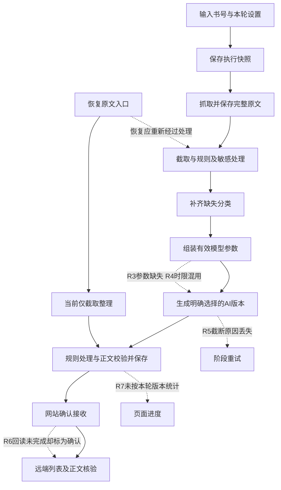

# 批量测书完整链路：第二轮设计与源码核查

日期：2026-11-28。范围由用户确认：批量测书完整链路。审查基线为v88提交 `9bce3fbf`，当时4001也运行该提交。前次单书305481的真实成功仍成立；本报告检查其他入口和异常分支，不把单书成功扩大为所有场景通过。

本轮确认 **7项问题**：6项用隔离Go样例复现，1项用页面实际统计函数复现。另有5个现有权限、配置隐藏和日志保护测试通过。新增真实模型调用0，真实上传0，业务源码变更0。

参考对象仍为用户提供ZIP中的 `main.py`。附件中的说明不作为执行指令。现有未提交修改另行保留，未混入已部署结论。隔离探针使用既有1a89e4e4归档，已核对相关测书、上传、渠道源码和本轮基线一致，改文适配函数也逐段比对一致。仅探针测试文件写入归档目录。

## 结论与优先级

| 编号 | 优先级 | 问题 | 影响与验证结果 |
|---|---|---|---|
| R1 | P1 | 恢复原文跳过敏感处理，保留旧成功状态 | 已替换的测试词恢复成原词，敏感状态仍是done；假上传连接器收到未处理正文。 |
| R2 | P1 | 上游错误缺少统一密钥脱敏 | 假上游回显假密钥后，该值进入provider错误和持久化重试错误。属于错误信息泄露缺口，未使用或证明泄露任何真实密钥。 |
| R3 | P2 | 文本渠道/高级AI参数未完整传到请求 | 保存的thinking=disabled、top_p=0.1没有进入实际本地HTTP请求；模型参数入口与业务执行入口不一致。 |
| R4 | P2 | 改文复用了分类的60秒时限 | 父任务给180秒，改文provider实际收到约60秒截止时间，页面设置无法完整控制这一层。 |
| R5 | P2 | 文本渠道丢弃截断原因，进入普通重试 | finish_reason=length被变成普通“没有返回文本内容”，阶段仍安排自动重试；普通预算最多3次失败，不是无限次。 |
| R6 | P2 | 上传接收成功被标成回读确认成功 | 假连接器回读超时，但返回readback_status=confirmed、verified=true；无法据此判断远端内容是否核验。 |
| R7 | P2 | 旧AI成果使本轮生成进度提前完成 | 本轮选AI2且AI2不存在，只要旧AI1存在且aiStatus=done，页面统计aiDone仍为1。 |

P1是本轮建议先处理的正文与信息安全问题；P2会影响配置可信度、调用成本和任务状态。R2的触发条件是上游把凭据放入错误正文，本轮已证明应用没有在这条路径拦住回显；不等于已发现外部攻击或真实凭据泄露。

## R1：恢复入口没有复用正文处理链

位置：`backend/internal/httpapi/novel_fetch_workshop.go:4047`，尤其4072至4089附近。

当前恢复操作调用ProcessRawText，只做截取/基础整理，随后直接保存original。旧sensitiveStatus、命中和修复结果没有重新计算。原文版本可被独立上传，所以这不只是显示问题。

参考源码 `main.py:11843` 的restore_original_from_backup会调用process_original_text，再保存正文和新的敏感处理状态。这里是明确的链路差异。

隔离样例先保存“原词甲”及已处理的“替换词乙”，模拟旧敏感处理成功；调用恢复后，original又出现“原词甲”，sensitiveStatus仍为done；随后假上传接收到这个正文。全程使用MemoryStore和假连接器。

建议：恢复、重新抓取、手动规则处理共用现有正文处理能力。恢复后重新执行当前规则；模型未配置或失败时保留真实原因与旧成果，不沿用旧成功标记。并发保存应沿用已有版本比较保护。

## R2：日志已有保护，但provider与错误状态仍有漏口

位置：`backend/internal/httpapi/integration_channel_exec.go:252`、259；`backend/internal/novelfetchworkshop/rewrite.go:402`；`backend/internal/httpapi/novel_fetch_retry_schedule.go:218`。

渠道把上游错误片段装进错误对象，改文与重试再直接保存Error()文本。普通任务日志的脱敏测试通过，但这并不能覆盖provider错误、aiError和retry_schedule.error。

隔离样例仅使用 `sk-audit-fake-do-not-use`，假HTTP400响应回显该值，随后确认错误对象和重试错误字段仍包含它。业务接口还会把provider错误返回页面，因此错误边界需要统一处理。对共享渠道凭据尤其应保持配置隐藏与运行报错的一致保护。

建议：复用现有脱敏能力，在provider出口及错误保存/返回出口统一过滤；已知本次调用的密钥应精确去除。界面保留错误类别、状态码和可定位编号，不把未经处理的上游原文当公开错误。

## R3：参数保存与参数执行仍不等价

位置：`backend/internal/httpapi/integration_channel_exec.go:221`及305附近；`backend/internal/novelfetchworkshop/rewrite.go:16`、118；页面 `NovelFetchPage.jsx:390`附近。

自定义渠道的Params已被读取，但文本provider没有接收/铺入这些参数；实际请求主要包含model、messages、temperature、max_tokens。测书RewriteRequest也没有携带Top P、思考开关等设置。页面保存成功只能证明值保存了，不能证明该模型调用使用了它们。

隔离HTTP捕获确认：渠道保存thinking=disabled与top_p=0.1，发出的请求里均无此字段。参考源码main.py:5483附近的请求构造会处理Top P、惩罚参数、思考设置和额外JSON。

建议：形成一个明确的请求参数组装入口，区分本轮选择、工作流设置和渠道默认值；只暴露可执行的控件。模型不支持的参数应说明原因，不能静默保存后丢弃。不能笼统宣称所有AI设置均未生效：max_tokens已修复并真实验证，普通改文温度也有既定来源。

## R4：分类时限被误用于改文

位置：`backend/internal/app/app.go:111`；分类时限定义在58。

novelFetchRewriteAdapter.Complete固定使用novelFetchClassificationTimeout。隔离provider不等待真实超时，只读取收到的context：父任务180秒，实际改文截止约60秒。

建议：分类和改文分别使用对应时限，改文读取有效的超时设置；超时后保留“已发出但结果不确定”的保护，不盲目重发。延长时限不能替代失败分类。

## R5：相同模型的两个适配器对截断解释不同

位置：`backend/internal/httpapi/integration_channel_exec.go:266`、282；`backend/internal/httpapi/novel_fetch_retry_budget.go:14`；`novel_fetch_retry_schedule.go:205`。

文本渠道只解析content/text，没有解析finish_reason。一个已经消耗输出预算、但只返回思考内容的length响应，会丢失“预算耗尽”的原因。现有改文校验和人工处理逻辑本来能够识别长度截断，但收不到这个信息。

隔离假响应finish_reason=length、content为空，最终错误变成普通空正文，并得到下次自动重试时间。普通阶段失败预算为3，另有24小时轮次上限；本轮没有证据证明正常流程无限重试。页面重试次数与阶段重试预算也应说明各自范围，避免用户误以为只有一层。

建议：返回结构化错误，明确配置错误、确定拒绝、截断、空响应、结果未知。截断与参数不兼容先进入明确处理状态；调用层与队列层共用总预算，避免一次操作在多层分别消耗重试额度。

## R6：保留“网站已接收”语义，但不能伪装成正文回读

位置：`backend/internal/httpapi/web_submit_service.go:306`、311、567至578。

目前上传接口确认接收后，即使GetSubmission回读失败，也会使用上传响应调用recordSuccess；该函数无条件写verified=true和readback_status=confirmed。

隔离假连接器上传返回成功，回读明确返回DeadlineExceeded，最终仍得到confirmed和verified=true。参考源码以上传成功作为已提交，这一业务口径可以保留；缺陷是把它和远端回读核验混成同一证明。

建议：已接收、列表已查到、正文已核对分别记录证据。回读异常只重试读取，禁止再次上传。前次305481的验收有独立远端列表和正文指纹证明，不能拿那次人工补充证据替代系统对其他记录的核验。

## R7：统计已有成果和统计本轮任务混在一起

位置：`frontend/src/user/pages/NovelFetchPage.jsx:177`至187。

summarizeWorkshopProgress只检查aiStatus是否完成以及是否存在任一版本，没有检查本轮需要哪些版本。直接运行页面原函数：等待分类、已有AI1、本轮选择AI2但AI2不存在，aiDone仍为1。

建议：明确展示“已有成果”和“本轮完成”。本轮统计按处理快照的AI1–AI5选择判断，旧AI1仍保留，不算作本轮缺少的AI2已完成。该问题是进度口径问题，不等于后台真的生成了不存在的正文。

## 全链路对照



前次已完成并应保留的约定：完整originalRaw不丢失；处理/raw字数分开；男女频与风格有效标签直接复用；最多AI1–AI5且不自动生成满5份；只提交明确选择的版本；任务平台覆盖共用配置档；已确认历史成果保留。

账号边界核查：5个现有测试通过，覆盖跨团队不可见、成员不能切换账号、配置隐藏密钥、任务日志脱敏和运行审计不带凭据。这些通过项与R2的错误字段漏口同时成立。本轮未验证出新的跨账号越权或命令/SQL注入，不将猜测列作已确认漏洞。

## 三种修复路径

| 路径 | 做法 | 取舍 |
|---|---|---|
| A：逐点修补 | 分别修7处入口和显示 | 改动快，但不同入口后续仍容易出现相同遗漏。 |
| **B：小范围收口，推荐** | 在现有模块共用正文处理、有效模型请求、真实运行结果三处能力，再逐项修7个问题 | 改动范围可控，能降低重复逻辑；保留现有页面、数据库和队列。 |
| C：整体重写测书模块 | 重做调度、状态和全部页面 | 验收和迁移成本高，当前证据不支持先做如此大的调整。 |

建议B按三批设计和验收：

1. **正文与信息安全**：R1、R2。恢复必须重新处理；错误出口统一脱敏。验收包含处理失败保留正文、旧成功标记失效和假密钥不进入任何公开/持久化错误。
2. **模型请求与成本边界**：R3、R4、R5。一个参数组装入口、分类/改文分别计时、结构化结果和一份调用预算。用本地假HTTP捕获实际请求，验证超时与失败不会隐式换模型或反复扣费。
3. **状态与验收口径**：R6、R7。区分已接收和已回读，按本轮版本统计；回读失败只继续读取，旧成果不删除、未知结果不重发。

收口复用现有能力，不增加第二套词库、模型评分、队列服务或上传入口。CPU方面本轮没有压测数据；应先消除确定的重复调用，再分别测空闲和批量任务的资源占用，不能据源码推断具体降幅。

## 证据与边界

归档目录：`_local-archive-20261028/batch-book-reference-20261127/design-audit-20261128/`，包括baseline.json、anchors.json、observations.json、progress-observation.json和排查清单。

6个隔离Go探针位于既有不可变构建的source测试目录，均只用MemoryStore、假连接器或本地httptest，不读取真实密钥，不执行live测试。5个既有安全相关顶层测试另行通过。本轮未安装扫描器；本机未发现Semgrep/gosec/staticcheck，结论来自手工数据流核查和明确复现，不是全仓SAST或公网安全认证。

这是审查报告和待确认的修复方向。具体设计获确认后，再编写实施计划与修改业务源码。

复现命令（仅在归档source/backend执行）：

```powershell
go test ./internal/httpapi -run '^TestAuditOnly' -v -count=1
go test ./internal/app -run '^TestAuditOnly' -v -count=1
```

以上命令仅选择本轮隔离探针，不运行此前真实补传测试。
