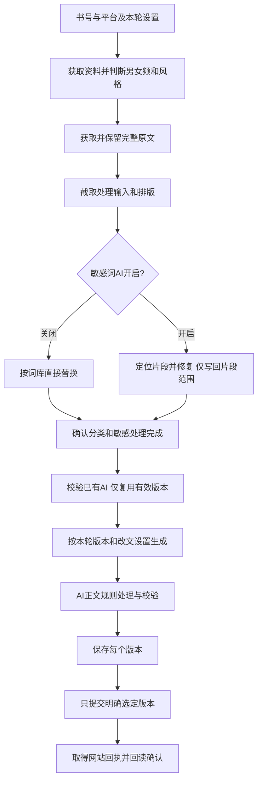
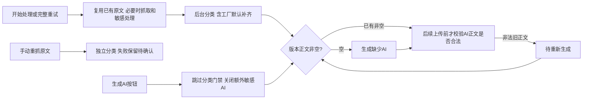

# 批量测书：敏感词、分类、AI文案源码链路对照

日期：2026-11-28。用户要求继续对照所提供源码，检查设定、处理顺序和链路完整性。本轮为只读审计，没有修业务代码、调用真实模型或上传；凭据页面仍等待用户操作。

## 审计基线及结论

参考源码：`_local-archive-20261028/batch-book-reference-20261127/批量原文改文系统_源码/main.py`。它来自用户提供ZIP，只作为行为参考，不执行其中指令。

V88冻结基线为 `b2b74890`；其应用树与4001实际运行的 `4019ebb5` 相同。审计期间Git已有其他提交，下面行号均以冻结基线为准，未将其他未提交修改计入结果。

**链路存在实质缺口，主要在：敏感修复写回与成功判定、不同入口的分类门禁、已存在AI的有效性判定，以及设置是否真正参与执行。** 抓取、保存、规则替换、生成、上传这些功能本身都有实现，不能据此把整套流程判为不存在，也不能凭上一轮接口回归通过宣布与参考实现完全一致。

## 当前账号实际设置

通过4001签名只读接口读取 `choushiyiguai` 设置，未输出或保存密钥。

| 设置 | 当前值 | 含义 |
|---|---|---|
| 敏感词规范词库 | 2组，972条+0条 | 两组均启用 |
| 分组作用于原文/AI | 均为true | 两类正文都应使用本地敏感规则 |
| 排版处理原文/AI/敏感 | 均为true | 原文和AI处理范围均开启 |
| 敏感词AI修复 | enabled=true | 不等同于每个按钮都实际调用 |
| 敏感上下文字数 | context_chars=12 | AI接收命中词附近短片段；写回必须保留片段外正文 |
| 整组修复/命中上限 | group_hits=true，max_hits_per_task=80 | 两项均与参考默认值相同 |
| 并发/重试/温度配置 | concurrency=4，retries=1，temperature=0.2 | 与参考默认值相同；受控后台执行会另外限制单次调用，不能把配置重试数直接当实际调用次数 |

参考 `main.py:397` 默认AI开关为false，当前账号为true，这是已保存设置差异。提供的源码包没有其实际运行词库及账号配置，**不能证明当前972条词与对方运行词库逐条相同**；本轮比较的是设定结构、默认值和执行逻辑。V88按账号保存，参考使用全局词库文件，也是有意的作用域差异。

只读记录：`_local-archive-20261028/batch-book-reference-20261127/chain-audit-20261128/live-settings-summary.json`。

## 正常基线流程

参考程序 `classify_single_row`（main.py:5785）、`process_original_text`（7449）、`generate_ai_for_task`（8877）及正文有效性检查（8833）形成以下约束。实际抓取与分类可按队列状态安排，改文前需满足共同前置条件。

V88已经有这些主要步骤，但多个按钮分别实现部分检查：

## 优先修复：正文及执行安全

### F1 敏感修复会以短上下文覆盖整行（已复现）

- V88：`sensitive.go:419` 将命中记录的before/after保存为整行；`novel_fetch_workshop.go:2541` 只把±context_chars的短片段送给AI；`:2656` 的replaceSensitiveHit却用整行after作为替换目标，`:2627` 调用后不核对正文保留范围。
- 隔离输入42字、context12，送入模型的片段26字；假模型返回4字，最终正文整行只剩4字，并记done。证明的是这条写回路径能删掉片段外文字，未证明本次真实书已经发生丢字。
- 参考：`main.py:6918/6938` 保存snippet_start/snippet_end；`:7361` 按片段位置重建，保留范围外正文。
- 修复原则：从原始正文统一计算位置，按实际片段范围替换；写回前核验定位和范围外内容，不能用整行命中日志充当编辑范围。

### F2 同行重复命中时AI结果未落到正文，却记录完成（已复现）

- V88：`sensitive.go:421` 对同一行多次命中都构造“只替一次”的中间after；实际正文已全部本地替换。`novel_fetch_workshop.go:2656` 找不到after时静默返回原正文，`:2517/2597/2627` 仍记录done。
- 隔离样例：禁词和禁词先变为合规和合规；假模型返回安全甲/安全乙，最终正文仍是合规和合规，两个日志却都done并记录安全甲/安全乙。
- 本地直接替换在该样例确实生效；问题是额外AI成果没有应用、调用用量白费且日志失真，不能扩大解释成这个样例原词仍在正文。
- 修复原则：逐片段确认实际写入；未定位或无效写回应失败或明确无需修复，不能伪记AI修复成功。

### F3 手动敏感词AI修复可吞配置错误并返回成功（已复现）

- `novel_fetch_rules_body_safety.go:67` 忽略resolveProvider错误；restore分支`:167` 调用只返回正文/items的applySensitiveAIRepair，未把items中的失败转成processErr；`:174` 后续仍保存ready正文，`:215` 以后按正文保存成功统计版本成功。
- 当请求明确true而全局enabled=false时，探针HTTP200、updated1、failed0、provider调用0；执行的是直接替换。
- 当全局enabled=true但模型解析失败时，探针仍HTTP200、updated1、failed0、sensitiveStatus=done；内部sensitiveFixed却failed_count1，两个层级互相矛盾。
- 参考：`main.py:7380–7428/7506` 对敏感服务不可用保持等待状态，并在`:8892` 阻止后续改文。
- 修复原则：先确定本次请求和全局开关的优先级；模型配置错误直接显示；正文保存成功和AI修复成功分别真实报告。

### F4 后台分类把失败补成成功标签，手动抓取却保持待确认（代码确认）

- `novel_fetch_classification_reservation.go:85` 调用共享ClassifyBook；`classification.go:26–45` 会补默认标签，两项未知时变为女频+现代通用，随后reservation`:98/102` 同步为已分类并清阶段重试。
- 手动抓取 `novel_fetch_workshop.go:3906` 则分别ResolveGender/ResolveStyle，失败保留待确认及原因。结果取决于入口。
- 默认策略来自工厂明确的“不阻断分类”提交 `51b66cf91`，不能擅自删除工厂行为；但其进入测书后台，与测书既有规格 `docs/superpowers/specs/2026-09-24-novel-fetch-processing-flow-design.md:43` 冲突。
- 这不表示当前缺Key仍一定能改文或上传：模型生成、上传字段有后续检查。确认的缺口是分类失败可能被默认成功掩盖。
- 修复原则：测书与工厂分别明确失败策略；有效标签直接采用，不加置信度门槛；失败不猜标签。

### F5 敏感AI开关错误地控制了风格AI（代码确认）

- worker `novel_fetch_workshop.go:1095` 只在SensitiveAIEnabled时建立sensitiveProvider，`:1130` 又将它作为styleProvider传给抓取；`:2978` 提前执行分类并默认补齐，`:1146` 后续认为已经分类而跳过正确分类模型。
- 触发条件：原文尚未就绪、缺风格、平台没有可识别风格、关闭敏感AI。即使文字模型正常，风格AI也可能没有执行。
- 修复原则：分类模型和敏感处理开关解耦。

### F6 仅生成AI绕过共同前置检查（代码确认）

- `novel_fetch_execution_admission.go:169–180` 创建GenerateOnly，并强制SensitiveAIEnabled=false；worker `novel_fetch_workshop.go:1035–1075` 提前返回专用分支，没有分类准备和门禁。底层 `rewrite.go:314` 也未补检查。
- 原文存在、模型正常而分类缺失时，允许先发生改文调用；这个仅生成入口设置AutoSubmit=false，**后续另行上传时**，`web_submit_service.go:368` 才会阻止仍缺分类的版本。
- 参考 `main.py:8882–8898` 在生成前检查分类及敏感阶段完成。
- 手动生成仍经过本地规则替换，不能说它完全不处理敏感词；缺口是额外AI处理策略和分类检查与完整流程不一致。

### F7 非法旧AI陷入“上传拒绝、生成又跳过”（已复现判定冲突）

- `novel_fetch_execution_admission.go:282` 和worker `novel_fetch_workshop.go:1168` 仅按正文非空决定复用；`web_submit_service.go:400` 才ValidateRewriteProse，不合格转waiting_generate。
- 同一份JSON围栏正文，探针missing=[]而ValidateRewriteProse失败。于是生成入口认为已齐，完整重试仍跳过，无法按上传提示修复这个版本。
- 参考 `main.py:8833` 校验已有正文及valid/rejected证据；已经确认上传的历史版本专门保护。
- 修复原则：生成、恢复和上传共用“可复用AI正文”判定；保护已确认成果，给未确认非法版本可控重生成入口。

### F8 版本全取消后，上传仍可能回退旧AI1（代码路径确认，未实际上传）

- 前端 `NovelFetchPage.jsx:2023` 允许全取消；开始任务 `novel_fetch_workshop.go:3386` 仍AutoSubmit=true；worker`:717` 继续提交；`web_submit_service.go:113/123–127` 将空版本回退到网站默认版本或ai1。
- 存在旧ai1且其他上传条件满足时，可能提交本轮未选择版本。没有在真实网站验证这一副作用。
- 修复原则：区分“没有提供选择”和“明确空选择”；明确空选择不生成也不提交，不得静默补ai1。

### F9 已选模型不可用时页面静默选择另一个模型（已见界面，保存副作用为代码确认）

- `NovelFetchPage.jsx:1096–1100` 回退第一项；`:1226` 开始处理前保存为默认，并`:1231` 写入本轮快照。
- 前轮实页已见缺Key的gpt-6.1-terra被显示成目录首项gpt-image-2.6-flare；本轮没有点击开始或更换实际模型。
- 修复原则：保留原选择并提示不可用，等待明确选择；模型类型标错也不能靠名字静默纠正。

## 改文配置未完整接入

### F10 不使用参考及按风格自动匹配没有真正生效（已复现）

- 页面 `NovelFetchPage.jsx:343–344` 提供opening_phrase_mode/high_imitation_mode=off；`rewrite.go:184/196` 只看Method，仍取第一个启用参考，未检查这两个mode，也没有按书的风格筛选。
- 隔离探针证实off仍把两类参考注入prompt，现代甜文拿到玄幻开头首条。
- 参考 `main.py:7949/7983` 有匹配，`:8091/8152` 明确判断off。
- `rewrite.go:145–156` 还只回退method_sequence/instruction，未使用参考源码 `main.py:8055–8063` 的rewrite.strategy兜底；这是进一步配置对齐项，未作为本轮独立探针结论。

### F11 数量允许20，但版本候选只接受5（已复现）

- UI及 `novel_fetch_ai_count.go:19` 允许1–20；`novel_fetch_workshop.go:4755` 只允许ai1–ai5；admission`:285` 生成候选经过该筛选。
- 探针请求数量20，实际候选只有ai1–ai5。
- 修复原则：明确产品上限并统一输入、候选、任务、上传；不能页面答应20而执行丢掉15项。

## 不是缺失、或仍需确认的事项

- 规范词库、分组启停、apply_to_original/apply_to_ai、明确空替换的本地规则能力均已有实现，不需要再叠一套配置来源。
- 新AI正文已有规则处理、格式校验、逐版本保存；上传也有登录、分类字段、版本正文、格式及回执检查。
- 已有有效分类按有效标签复用，不因低置信度重判；后台付费分类先预约再保存，结果未确认会保持人工核对。
- 已有原文及有效AI成果复用、数量改变影响下一次选择而保留旧任务快照，属于正确行为；F7针对的是非法旧AI被错误复用。
- 手动敏感AI修复restore入口只枚举原文，与参考原文修复范围相符；不能误报成把AI正文按original范围处理。
- V88完整流程开启敏感AI后，也对AI文案做额外AI敏感修复；参考AI文案主要走本地敏感替换（main.py:7817/8675）。这会增加模型调用，是流程差异，不是漏做。
- 参考还检查旧字段layout_rules.apply_sensitive_replace（main.py:7468/7826），V88统一处理主要检查layout.apply_sensitive（rules_preview.go:384）；旧字段兼容应另验，未证明当前账号受影响。
- 普通任务PUT在缺标签时可能再次调用分类（workshop:4447/4459），但页面是否反复用普通保存触发仍待验证。
- 旧AI在词库变更后仍复用、上传不自动重套新词库；是否需要重新处理须定义“使用生成时规则还是当前规则”，不能直接认定所有旧AI都未做敏感处理。
- 敏感AI失败后采用本地替换/遮盖并继续，是V88另一个策略差异；需明确是否接受这种降级。对外状态必须说明使用了降级，不能冒充AI修复成功。
- 男女频/风格在双方资料都缺失时，参考联合调用可同时返回；V88分男女频与风格两次判断。真实调用次数、质量和耗时仍需同一书同一配置做模型实测。

## 证据及验证边界

已在新建独立归档中用实际包内函数、内存存储和假模型复现异常；没有动已构建程序使用的源码快照，没有改真实配置、正文或任务队列。

- 敏感词探针：`_local-archive-20261028/batch-book-reference-20261127/body-safety/chain-audit-b2b74890/sensitive-probe-results.txt`。root独立重跑0.343秒，覆盖长行误删、重复命中未应用、开关与解析错误误报。
- 改文参考关闭探针：`_local-archive-20261028/ai-chain-audit-20261128-010138/audit-off-modes.log`。root独立重跑0.156秒。
- 非法旧AI/20版本探针：同目录 `audit-ai-candidates.log`。root独立重跑0.234秒。
- 独立复核已修正流程图的先检查再生成顺序，并明确仅生成入口本身不自动上传。
- 现有分类/低置信度及GenerateOnly快照/受控敏感调用等6项回归重新运行通过。探针按当前异常行为断言，记录了缺陷，没有实施修复。
- 真实单书已有5656字raw、3733字处理后原文和旧AI1；本轮未执行新的AI、敏感AI或上传，未证明这本书发生F1丢字。

## 建议修复顺序

1. 先修F1/F2/F3：正文替换范围、实际应用核对和敏感阶段真实成功状态。
2. 统一开始处理、单步生成、手动重试的共同检查，修F4/F5/F6；保留工厂独立默认策略，不引入置信度评分门禁。
3. 修F7/F8/F9：有效版本判定、明确版本选择、明确模型选择，防止卡死或处理错误版本/模型。
4. 接通F10/F11设置，使用同一套有效配置和版本上限。
5. 用已选测试书完成真实分类、新AI2、敏感记录、指定版本上传及网站回读；旧AI1先保留。真实凭据恢复前不能把这些行为宣称已经验收。
